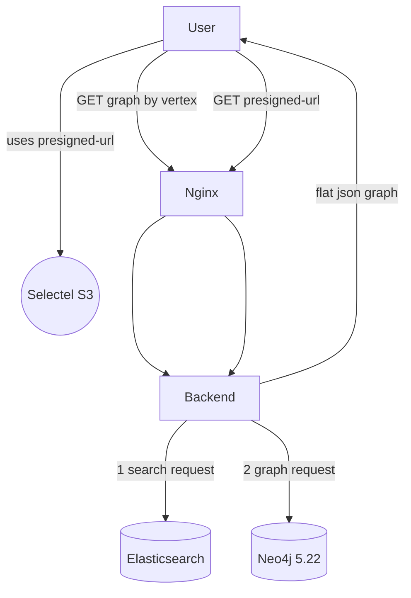
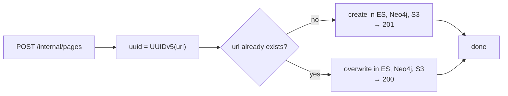

# WikiGraph


[preview.webm](https://github.com/user-attachments/assets/90aec15f-941c-4257-be6a-912b00f6db9f)


The user searches for articles through a graph of connections, clicks on a vertex, and opens an HTML page from object storage.

Search is powered by Elasticsearch, the graph lives in
Neo4j, and HTML content is stored in S3. All three storages are linked via a `uuid`
derived deterministically from the `url`.

The `URL` doesn't have to follow the `/example/page1` format, but writing it this way is recommended, because the uuid = UUIDv5(url) is derived deterministically from the URL, and a predictable format simplifies deduplication.

- a modular open-source analog of Obsidian's core feature, built as a website
- you can use this project as a foundation for your own version of "WikiGraph" or a search engine
- convenient data migration (a clear example via the admin panel), plus a ready-made [ETL pipeline](#about-the-etl-process)
- a complete, ready-to-use ecosystem


## Running
Fill in `secret_example.tfvars` with your own values (required for the OpenStack provider), then:

```bash
cd infra
mv secret_example.tfvars secret.tfvars
terraform fmt && terraform init
terraform plan -var-file="secret.tfvars"  # optional
terraform apply -var-file="secret.tfvars"
```
Fill in the parameters of .env.example prefixed with S3 using the data of the created bucket (found in the connection details section), then run:

```bash
cp .env.example .env
```
Launch:

```bash
docker compose up -d   # from the repo root
```

## Minimum hardware requirements
~ 8 GB RAM, 2 CPUs; can be adjusted in ./infra/server in the openstack_compute_flavor_v2 resource.

## Request architecture


---

Insert idempotency:


## API

| Method | Path | Purpose |
| --- | --- | --- |
| GET | `/api/search?q=&lang=&size=` | search via ES |
| GET | `/api/graph/{uuid\|url}?k=` | graph around a node, `1 ≤ k ≤ 5` |
| GET | `/api/page/{uuid}/url` | presigned URL for the HTML |
| GET | `/api/backlinks/{uuid\|url}` | incoming links |
| GET | `/api/random` | random page |
| GET | `/health` | status of the three storages; 503 if anything is down |
| GET | `/stats` | counts of Pages / Stubs / edges |
| POST | `/internal/pages` | insert or overwrite a page |

## Example requests
Listed in scripts/seed.sh; run:
```bash
./scripts/seed.sh   # from the repo root; the ports must be exposed externally
```

## Development
Building the backend:
```bash
cd backend
go mod tidy
set -a && source ../.env && set +a
go run ./cmd/server
```
Building the frontend:
```bash
cd frontend
npm install
npm run build
npm run dev
```

Building the admin panel:
```bash
cd admin
python3 -m venv venv && source ./venv/bin/activate # or python
pip3 install -r requirements.txt
python3 src/main.py
```

## About the ETL process
As an example, an ETL pipeline was created in ./pipeline/src,
and anyone can run it:
```bash
docker compose -f compose.pipeline.yml up -d
```
This script uses vertex.json to build the graph connections (a smaller vertex.example.json is provided). The contents of each vertex (the content itself and its metadata) are fetched from the open **wikipedia.org** API. This part of the project is needed to:
1. Test the server on real data
2. Check whether the system can handle a large volume of inserts
3. Collect metrics for analysis


## AI agents
Since I handle the **architecture**, **infrastructure**, and **backend** single-handedly, I delegated writing the tests and the frontend (UI) to AI agents.

The frontend UI layer (components, pages, styles) was built by **Kimi K3 CLI**; via setfacl it was granted access to `frontend/` and `.git/`, as well as read access to everything except `.env` and `infra/secret.tfvars` (a security measure).

It took 4 prompts: an initial one (based on `Agents.md` / `TODO.md` / `doc/architecture.md`), one bug fix, and two cosmetic tweaks. The Dockerfile and the Nginx config were written by hand before the agent was brought in — the agent didn't change them, even though it had write access.


## License
- This project is distributed under the MIT license, see [LICENSE](LICENSE)


## Why this project exists
- To grow as a DevOps engineer
- To expand my tech stack
- To learn how to build infrastructure


## Contacts
- Telegram: [@N_u_l_l_N_o_n_e](https://t.me/N_u_l_l_N_o_n_e)
