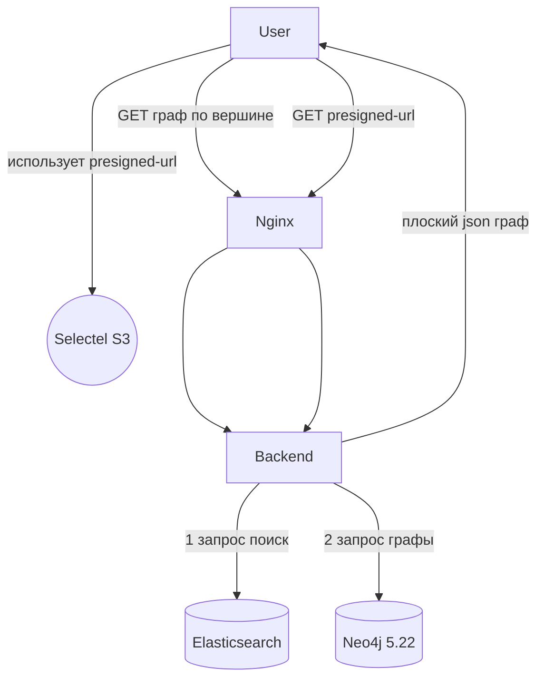
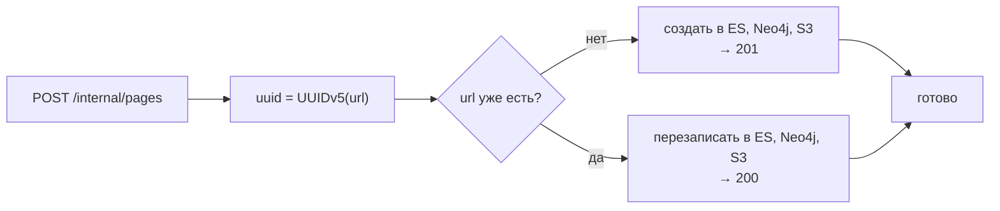

# WikiGraph


Пользователь ищет статьи через граф связей, кликает по вершине и открывает HTML-страницу из объектного хранилища.

Поиск через Elasticsearch, граф — в
Neo4j, HTML-контент — в S3. Все три хранилища связаны через `uuid`,
детерминированный от `url`.

`URL` может не быть формата `/example/page1` но так писать рекомендуется, потому что от URL детерминируется uuid = UUIDv5(url), и предсказуемый формат упрощает дедупликацию

- модульный opensource аналог главной фичи Obsidian в виде вебсайта
- можно использовать этот проект как основу для своей версии "WikiGraph" или поисковой системы
- удобная миграция данных (понятный пример через админку), а также готовый [ETL pipeline](#По-поводу-ETL-процесса)
- выстроена готовая экосистема


## Запуск
Заполните `secret_example.tfvars` своими значениями (нужно для openstack провайдера), затем:

```bash
cd infra
mv secret_example.tfvars secret.tfvars
terraform fmt && terraform init
terraform plan -var-file="secret.tfvars"  # опционально
terraform apply -var-file="secret.tfvars"
```
Заполните параметры .env.example с префиксом S3 данными созданного бакета (хранятся в разделе данные подключения), выполните:

```bash
cp .env.example .env
```
Запуск:

```bash
docker compose up -d   # в корне
```

## Минимальные требования к железу
~ 8 ГБ RAM, 2 CPU; можно изменить в ./infra/server в ресурсе openstack_compute_flavor_v2.

## Архитектура запросов


---

Идемпотентность вставки:


## API

| Метод | Путь | Назначение |
| --- | --- | --- |
| GET | `/api/search?q=&lang=&size=` | поиск через ES |
| GET | `/api/graph/{uuid\|url}?k=` | граф вокруг узла, `1 ≤ k ≤ 5` |
| GET | `/api/page/{uuid}/url` | presigned URL на HTML |
| GET | `/api/backlinks/{uuid\|url}` | входящие ссылки |
| GET | `/api/random` | случайная страница |
| GET | `/health` | статус трёх хранилищ, 503 если что-то лежит |
| GET | `/stats` | количество Page / Stub / рёбер |
| POST | `/internal/pages` | вставка или перезапись страницы |

## Примеры запросов
Указаны в scripts/seed.sh, запуск:
```bash
./scripts/seed.sh   # в корне; нужно чтобы порты были проброшены наружу
```

## Для разработки
Сборка бэкенда:
```bash
cd backend
go mod tidy
set -a && source ../.env && set +a
go run ./cmd/server
```
Сборка фронта:
```bash
cd frontend
npm install
npm run build
npm run dev
```

Сборка админки:
```bash
cd admin
python3 -m venv venv && source ./venv/bin/activate # или python
pip3 install -r requirements.txt
python3 src/main.py
```

## По поводу ETL процесса
В качестве примера был создан etl pipeline в ./pipeline/src,
его может запустить каждый:
```bash
docker compose -f compose.pipeline.yml up -d
```
Этот скрипт использует vertex.json для построения связей графов (предоставлен vertex.example.json меньшего размера). Содержимое каждой вершины (сам контент и метаданные) берутся из открытого API wikipedia.org. Эта часть проекта необходима чтобы:
1. Проверить работу сервера на реальных данных
2. Проверить, справляется ли система с большим количеством вставок
3. Собрать метрики для анализа


## Лицензия
- Этот проект распространяется под лицензией MIT см. [LICENSE](LICENSE)


## Зачем нужен проект
- Для развития как DevOps инженер
- Расширить свой стек
- Научиться строить инфру


## Контакты
- Telegram: [@N_u_l_l_N_o_n_e](https://t.me/N_u_l_l_N_o_n_e)